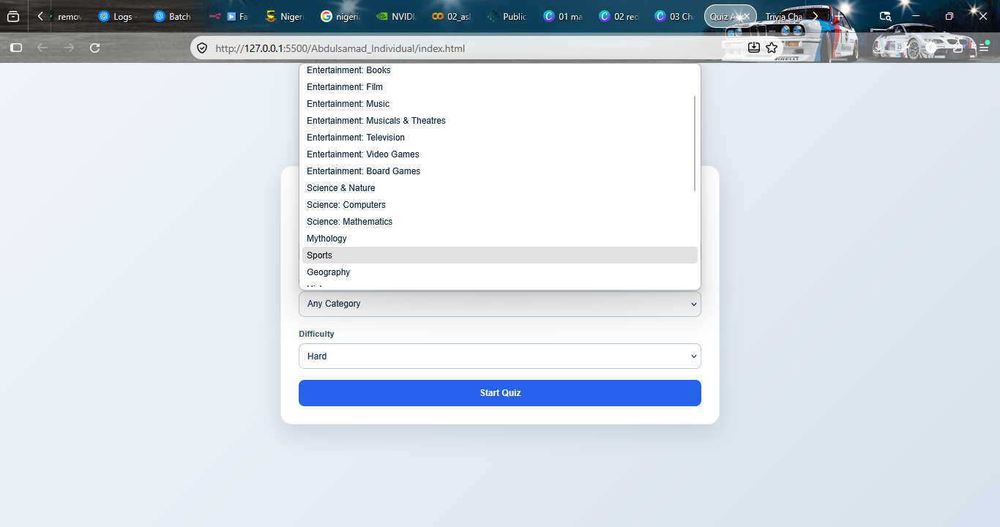
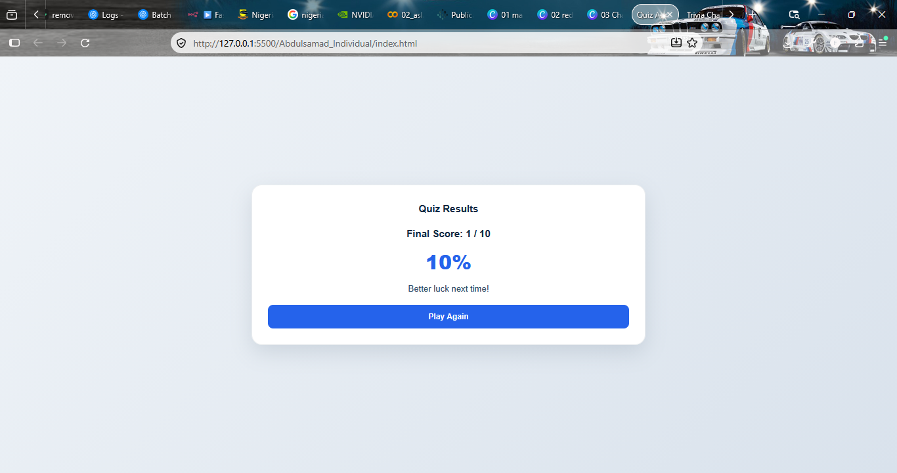
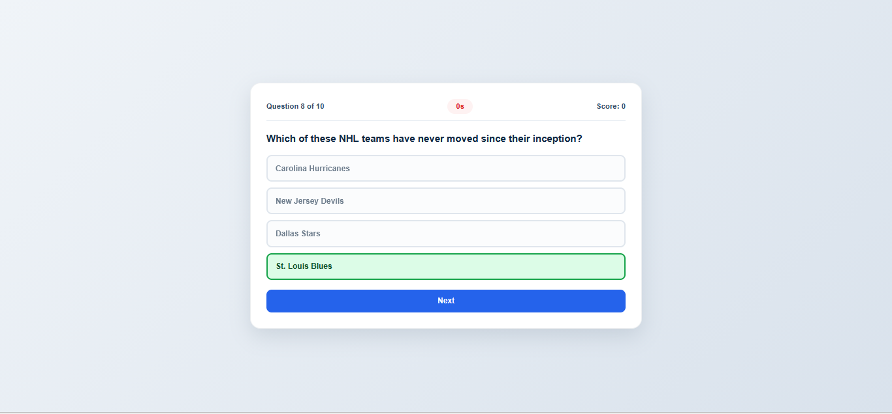

# Quiz App

A timed trivia quiz web application built with HTML, CSS, and vanilla JavaScript using the Open Trivia DB API.

## How to Run

1. Open `index.html` directly in your web browser (or serve the `Quiz App` folder with a local static server).
2. Choose a category and difficulty (or leave them on "Any").
3. Click **Start Quiz** and answer each of the 10 questions within 15 seconds.

## APP Screenshots

